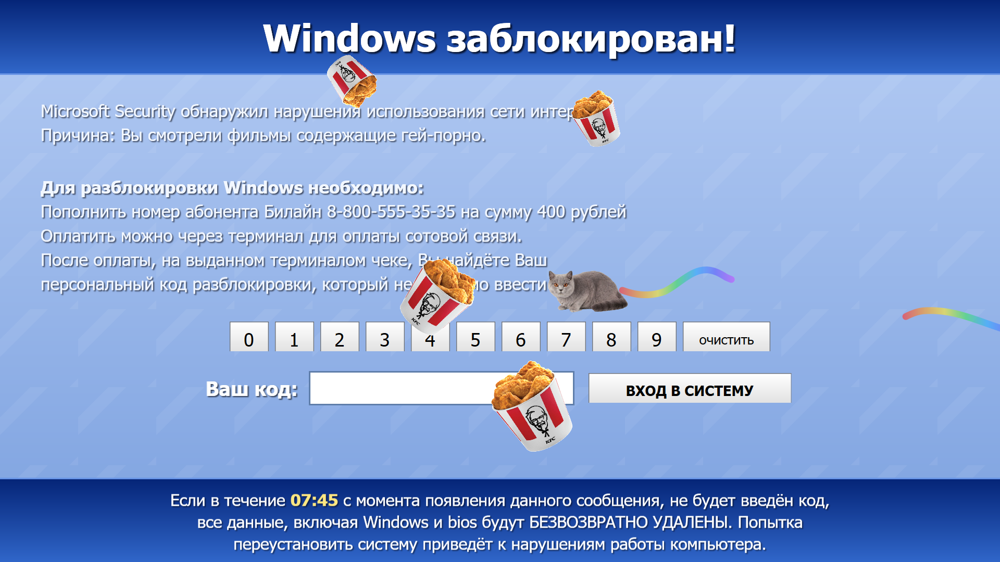
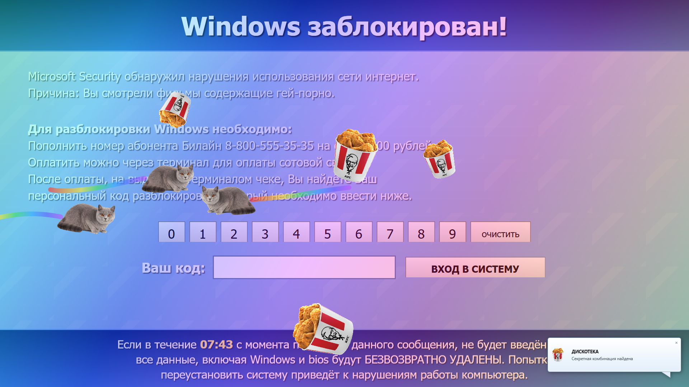

# Fake WinLocker — WinLockerKFC

[](#)
[](LICENSE)

Шуточный «винлокер» для **безвредного пранка** над другом, который заранее
согласился на съёмку. Полноэкранная шутка в стиле старого
«Windows заблокирован»: синий экран, таймер, вёдра KFC, летающие коты,
курицы, фейковая капча и достижения в стиле Windows 7.

> **Важно.** Это не вирус и не программа-вымогатель. Приложение ничего не
> шифрует, не удаляет, не крадёт и не прописывается в автозагрузку.
> Но если таймер истечёт, компьютер **принудительно перезагрузится**
> (`shutdown /r /f`), поэтому несохранённые документы будут закрыты.
> Запускай только на своём ПК или на ПК друга, который дал согласие.

## Скриншоты / Screenshots

**Обычный экран / Lock screen**



**Disco-режим (K → F → C) / Disco mode**



## RU

### Что это

- Полноэкранный синий экран «Windows заблокирован!», таймер 8:00.
- Пароль **3015** — вводится с экранной клавиатуры или с клавиатуры.
- Музыка: ICEGERGERT — «Агент провокатор» (с 9-й секунды, тихий фон,
  скрытая «злая» громкость).
- 28 случайных звуков каждые 5–10 секунд: коты, собаки, пуки, кукареканье
  и прочее. Иногда играют по 2–3 одновременно.
- Три кота летают по экрану с радужным следом и случайно меняют скорость.
- На кукареканье по низу экрана выбегают курицы.
- Опаковые вёдра KFC летают, вращаются и отскакивают друг от друга
  (до 30 штук). Коты и курицы на их физику не влияют.
- Клик по коту — «мяу». Клик по ведру — из него вылетают 4–6 жареных
  крылышек и хрустит корочка. Курицы — просто декорация.
- Неверный код: звук стекла, тряска экрана и «трещины».
- Последние 30 секунд: красная пульсация и сердцебиение.
- Достижения в виде уведомлений Windows 7 (36 штук: время, ввод кода,
  ошибки, капча, коты, вёдра, куры, секреты) и фейковая капча Aero
  с британскими вислоухими котами.
- Секретный disco-режим: нажать **K**, затем **F**, затем **C**.
- Финал: «ШУТКА! Это был пранк. Ничего не удалено. С тебя ведро крылышек
  КФС!» + фанфары и кукареканье.

### Быстрый старт

1. Скачай `WinLockerKFC.7z` из раздела **Releases**.
2. Пароль архива: **123** (шифруются и содержимое, и имена файлов).
3. Распакуй **7-Zip** или **WinRAR**, запусти `WinLockerKFC.exe`.
4. Для полного режима (скрытие пунктов Ctrl+Alt+Del) запусти
   «от имени администратора» и подтверди UAC.

Файл не подписан, поэтому SmartScreen может предупредить:
«Подробнее» → «Выполнить в любом случае».

### Коды и горячие клавиши

| Действие | Комбинация |
| --- | --- |
| Разблокировать | `3015` |
| Аварийный выход | `Ctrl+Shift+Q` |
| Тихая / громкая музыка | `Ctrl+Shift+L` |
| Disco-режим | `K` → `F` → `C` |
| Восстановить политики после сбоя | `WinLockerKFC.exe --restore` |

### Сборка из исходников

Нужны Windows 10/11, .NET Framework 4.x, `csc.exe` из состава Windows
и `rc.exe` из Windows SDK.

```powershell
powershell -ExecutionPolicy Bypass -File .\build.ps1
```

Результат — `WinLockKFC.exe`. Лаунчер распаковывает рабочую часть в
`%LOCALAPPDATA%\Microsoft\Windows\WUDFHost.exe`, запускает её и закрывается.
Процесс в Диспетчере задач выглядит как `WUDFHost.exe`, но его путь виден:
это косметическая маскировка, а не сокрытие.

**Медиафайлы.** Музыкальные треки (`music.mp3`, `music_loud.mp3`) не входят
в репозиторий по юридическим причинам. Положи свои файлы с этими именами
рядом с `build.ps1` — сборка подхватит их автоматически. Без музыки
программа тоже собирается и работает, просто молча.

### Структура репозитория

```
WinLock.cs            рабочая часть: интерфейс, эффекты, капча, звуки
Launcher.cs           лаунчер, распаковывает payload и запускает его
build.ps1             сборка exe (payload + launcher)
payload.rc / .manifest  ресурсы и манифест рабочей части
launcher.rc / .manifest ресурсы, иконка и метаданные лаунчера
*.png                 спрайты ведра, кота, курицы и крылышка
sfx/                  колода коротких звуков
cue_*.mp3             служебные звуки (стекло, сердцебиение, фанфары, хруст, достижение)
README_ПРАНК.txt      подробная инструкция (RU + ENG)
LICENSE               лицензия MIT
NOTICE.md             сторонние материалы и права
```

### Ответственное использование

- Только ПК, владелец которого согласился на пранк.
- Не запускай на рабочих, учебных и чужих компьютерах.
- Предупреди заранее: через 8 минут будет принудительная перезагрузка.
- Не используй для шантажа, вымогательства или сокрытия данных.
- Автор не несёт ответственности за последствия нарушения этих правил.

### Лицензия

Код распространяется по лицензии **MIT** (см. `LICENSE`).
Сторонние изображения, музыка и звуки не покрываются MIT — права
принадлежат их авторам, подробности в `NOTICE.md`.

---

## ENG

### What it is

A joke full-screen "Windows is locked!" prank for a **friend who agreed**
to be filmed. It imitates an old ransomware screen and is completely harmless:
no encryption, no file deletion, no data theft, no autostart.

> **Warning.** When the 8-minute timer runs out the app **force-reboots**
> the PC (`shutdown /r /f`), so unsaved documents will be closed.
> Run it only on your own machine or on a consenting friend's machine.

### Features

- Full-screen blue "Windows is locked!" screen with an 8:00 timer.
- Password **3015**, typed on the on-screen or physical keyboard.
- Music by ICEGERGERT (starts at 0:09, quiet background, hidden loud mode).
- 28 random sounds every 5–10 seconds (cats, dogs, farts, rooster, etc.),
  sometimes 2–3 at once.
- Three cats fly around with rainbow trails and random speed changes.
- Chickens run along the bottom of the screen when the rooster crows.
- Opaque KFC buckets bounce, spin and multiply (up to 30).
  Cats and chickens never affect bucket collisions.
- Click a cat — "meow". Click a bucket — 4–6 fried wings fly out and the
  crust crunches. Chickens are decoration only.
- Wrong password: glass sound, screen shake and cracks.
- Last 30 seconds: red pulsing overlay and heartbeat.
- Windows 7 style achievement toasts (36 of them: time, code entry,
  mistakes, captcha, cats, buckets, chickens, secrets) and a fake Aero
  captcha with British lop-eared cats.
- Secret disco mode: press **K**, **F**, **C**.
- Finale: "JOKE! It was a prank. Nothing was deleted. You owe me a bucket
  of KFC wings!" with fanfare and a rooster.

### Quick start

1. Download `WinLockerKFC.7z` from **Releases**.
2. Archive password: **123** (content and file names are encrypted).
3. Extract with **7-Zip** or **WinRAR** and run `WinLockerKFC.exe`.
4. For full mode (hiding Ctrl+Alt+Del items) run as administrator
   and confirm the UAC prompt.

The executable is unsigned, so SmartScreen may warn you:
"More info" → "Run anyway".

### Hotkeys and codes

| Action | Shortcut |
| --- | --- |
| Unlock | `3015` |
| Emergency exit | `Ctrl+Shift+Q` |
| Quiet / loud music | `Ctrl+Shift+L` |
| Disco mode | `K` → `F` → `C` |
| Restore policies after a crash | `WinLockerKFC.exe --restore` |

### Building from source

Requires Windows 10/11, .NET Framework 4.x, `csc.exe` from Windows and
`rc.exe` from the Windows SDK.

```powershell
powershell -ExecutionPolicy Bypass -File .\build.ps1
```

The output is `WinLockKFC.exe`. The launcher extracts the payload to
`%LOCALAPPDATA%\Microsoft\Windows\WUDFHost.exe`, starts it and exits.
Task Manager shows a `WUDFHost.exe` process, but its path is visible:
this is cosmetic disguise, not real hiding.

**Media files.** The music tracks (`music.mp3`, `music_loud.mp3`) are not
included in the repository for legal reasons. Put your own files with these
names next to `build.ps1` — the build picks them up automatically.
The project builds and runs without music, just silently.

### Responsible use

- Only on a PC whose owner consented to the prank.
- Never on work, school or someone else's computer.
- Warn the victim in advance about the forced reboot after 8 minutes.
- Never use it for blackmail, extortion or hiding data.
- The author is not responsible for misuse.

### License

The source code is released under the **MIT** license (see `LICENSE`).
Third-party images, music and sounds are not covered by MIT; all rights
belong to their respective authors. See `NOTICE.md`.
